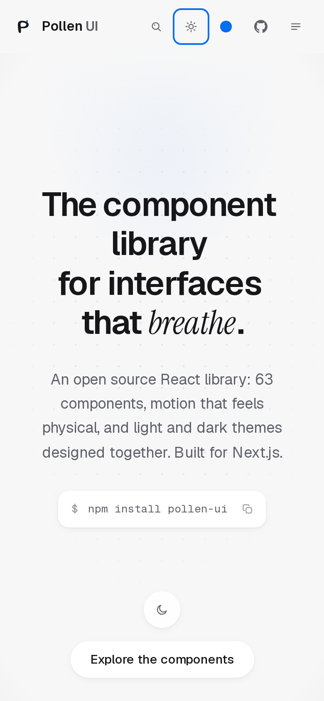
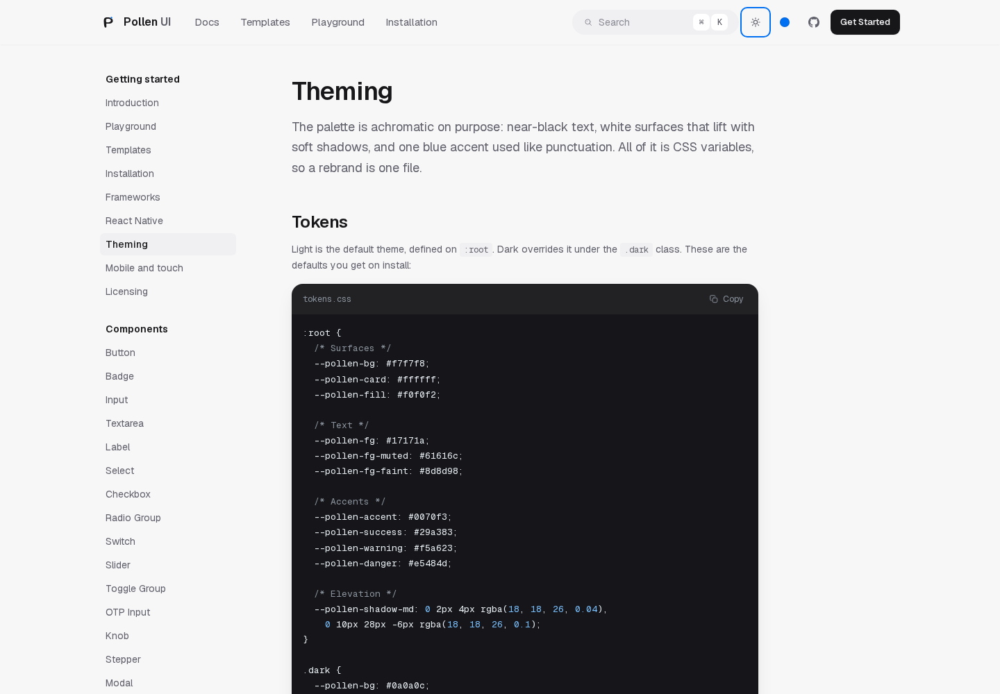
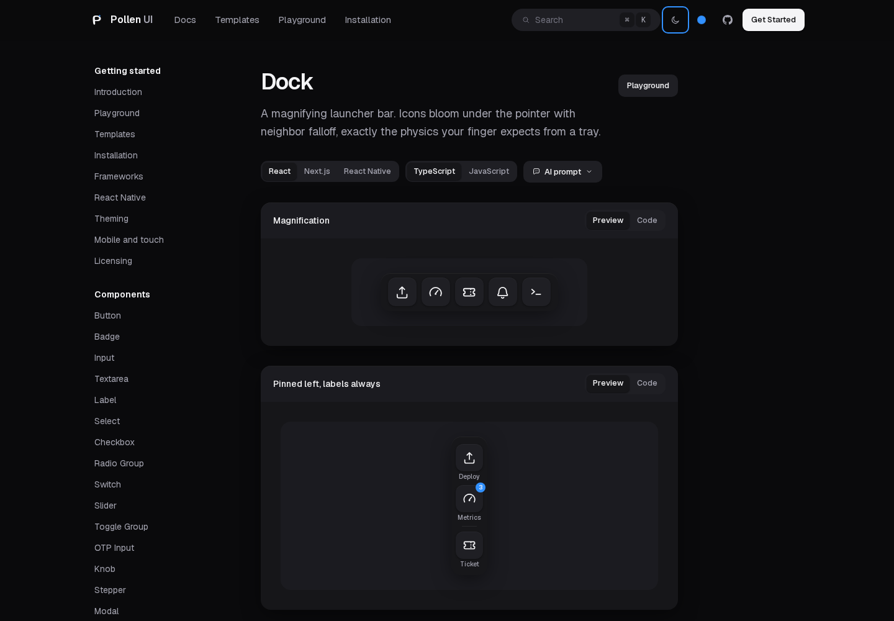

<div align="center">

# Pollen UI

**React components for Next.js, with a design language that behaves.**

Careful typography, layered shadows instead of borders, one blue accent
used like punctuation, and spring motion that only shows up where things
can be interrupted. Light and dark are both first-class.

[](https://github.com/1-Pankaj/pollen-ui/actions/workflows/ci.yml)
[](https://github.com/1-Pankaj/pollen-ui/actions/workflows/pages.yml)
[](https://www.npmjs.com/package/pollen-ui)
[](LICENSE)
[](https://react.dev)
[](https://nextjs.org)
[](https://tailwindcss.com)

[Documentation](https://1-pankaj.github.io/pollen-ui/) ·
[Playground](https://1-pankaj.github.io/pollen-ui/playground) ·
[Templates](https://1-pankaj.github.io/pollen-ui/templates) ·
[Releases](https://github.com/1-Pankaj/pollen-ui/releases) ·
[Contributing](CONTRIBUTING.md)


</div>

## Contents

- [Why Pollen UI](#why-pollen-ui)
- [Packages](#packages)
- [Getting started](#getting-started)
- [Components](#components)
- [Icons](#icons)
- [Theming and design tokens](#theming-and-design-tokens)
- [Templates](#templates)
- [The documentation site](#the-documentation-site)
- [React Native](#react-native)
- [Built to be depended on](#built-to-be-depended-on)
- [Screenshots](#screenshots)
- [Documentation index](#documentation-index)
- [Local development](#local-development)
- [Publishing and deployment](#publishing-and-deployment)
- [Contributing](#contributing)
- [License](#license)

## Why Pollen UI

Most component kits hand you a catalog and let the details drift.
Pollen UI is built around a smaller idea: every component obeys the
same design rules, so an app assembled from them looks like it was
designed by one person.

- **Achromatic, then one accent.** Near-black ink on white surfaces,
  `#0070f3` where the eye needs to land, nothing else competing.
- **Shadows, not lines.** Nothing on screen is drawn with a hard
  border; surfaces separate through soft elevation and tonal fills.
- **Motion with rules.** Ease-out entrances under 300ms, springs only
  where interruptions happen, overlays scaling from their trigger —
  never from scale zero.
- **Dark mode is a real theme**, driven entirely by CSS variables and
  re-tintable in one file.

## Packages

This repository is a small monorepo with three packages:

| Package | What it is | Links |
| --- | --- | --- |
| [`pollen-ui`](packages/pollen-ui) | The web library: 63 components in five families, 103 icons, TypeScript types, stylesheet and Tailwind bridge. | [README](packages/pollen-ui/README.md) · [npm](https://www.npmjs.com/package/pollen-ui) |
| [`@pollen-ui/tokens`](packages/tokens) | The design tokens as plain TypeScript — colors, surfaces, shadows, radii, spacing, type scale, spring presets. | [README](packages/tokens/README.md) · [npm](https://www.npmjs.com/package/@pollen-ui/tokens) |
| [`@pollen-ui/native`](packages/native) | The same design language on iOS and Android: React Native primitives sharing the tokens core. | [README](packages/native/README.md) · [npm](https://www.npmjs.com/package/@pollen-ui/native) |

Web apps only ever need `pollen-ui`. The scoped packages publish under
the `@pollen-ui` scope — the bare `@pollen` scope on npm belongs to an
unrelated account.

## Getting started

Pollen UI targets React 18 and 19 with Tailwind CSS 4 configured —
Next.js (App Router or Pages Router), Vite, Remix, Astro islands,
anywhere React renders. The
[Installation guide](https://1-pankaj.github.io/pollen-ui/docs/installation)
covers each framework in detail.

### Install

From npm:

```bash
npm install pollen-ui
```

Or install straight from this repository:

```bash
git clone https://github.com/1-Pankaj/pollen-ui.git
cd pollen-ui
npm install
npm run build:lib
npm install ./packages/pollen-ui
```

### Wire up Tailwind once

```css
/* app/globals.css */
@import "tailwindcss";
@import "pollen-ui/styles.css";
@import "pollen-ui/theme.css";
@source "../node_modules/pollen-ui/dist";
```

- `styles.css` — design tokens, focus styles and keyframes.
- `theme.css` — the Tailwind 4 bridge: maps utilities like `bg-card`,
  `text-faint` and `bg-fill-strong` onto the tokens so component
  colors follow light and dark automatically.
- `@source` — points your Tailwind build at the installed package.

### Use any component

```tsx
import { Button } from "pollen-ui";

export default function Page() {
  return <Button>Ship it</Button>;
}
```

Fonts: the components expect Geist Sans/Mono (and use Instrument Serif
for display accents on the docs site). On Next.js, load them with
`next/font/google`; the
[Installation page](https://1-pankaj.github.io/pollen-ui/docs/installation)
shows the exact snippet.

## Components

63 components in five families, every one documented with a live demo,
a props table and a playground under
[/docs](https://1-pankaj.github.io/pollen-ui/docs):

| Family | Components |
| --- | --- |
| **Primitives** | Button, Badge, Input, Textarea, Label, Select, Combobox, Checkbox, Radio Group, Switch, Slider, Rating, Tag Input, Toggle Group, OTP Input, Pagination |
| **Overlays** | Modal, Drawer, Popover, Tooltip, Dropdown Menu, Context Menu, Command, Toast, Toast Pile |
| **Display** | Tabs, Breadcrumb, Accordion, Avatar, Alert, Skeleton, Spinner, Progress, Progress Ring, Kbd, Table, Card, Code Block, Segmented Control, Steps, Timeline, Stat, Empty State |
| **Motion** | Reveal, Text Reveal, Marquee, Scroll Progress, Parallax, Number Ticker, Typewriter |
| **Signatures** | [Dock](https://1-pankaj.github.io/pollen-ui/docs/dock), Kinetic Headline, Magnetic Button, [Odometer](https://1-pankaj.github.io/pollen-ui/docs/odometer), Scramble Text, [Slide to Confirm](https://1-pankaj.github.io/pollen-ui/docs/slide-to-confirm), [Chat](https://1-pankaj.github.io/pollen-ui/docs/chat), Pressable Card, Ticket Card, Tilt Card |

## Icons

The library ships with its own hand-drawn icon set (103 glyphs on a
24px grid, one stroke weight, a recurring seed motif) and has **zero
icon dependencies**. Nothing to install, nothing to tree-shake around:

```tsx
import { IconSeed, IconDeploy, IconPetal } from "pollen-ui";
```

Every component renders these glyphs internally, so replacing
lucide-react or any other icon pack is a deletion, not a migration.

## Theming and design tokens

Everything visual is a CSS variable. Import the tokens once, and a
rebrand is one file:

```tsx
// app/layout.tsx
import "pollen-ui/styles.css";
```

The [Theme Studio](https://1-pankaj.github.io/pollen-ui/docs/theming)
picks an accent, tints surfaces and sets shadow depth live, then hands
you the CSS. Prefer the tokens in TypeScript? They ship as data too:

```tsx
import { light, dark, springSnappy } from "pollen-ui/tokens";
```

The same vocabulary backs
[`@pollen-ui/tokens`](packages/tokens) on React Native, and
[`scripts/check-tokens-sync.mjs`](scripts/check-tokens-sync.mjs) fails
CI when any of the three copies drift apart.

## Templates

26 prebuilt heroes, navbars, dashboards and page sections in the
[templates gallery](https://1-pankaj.github.io/pollen-ui/templates) —
each preview with its own light/dark switch, each template opening
into a page with the complete copyable source, a TypeScript/JavaScript
switch, the components it uses and an AI-agent prompt.

## The documentation site

The repository includes a full documentation site, and it exercises
everything the library ships:

- **Playground on every component page** — a CodeMirror editor plus an
  in-browser build of the real library. Flip a prop, watch the snippet
  rewrite itself. Syntax and runtime errors surface in an error pane;
  code persists locally per component.
- **Theme Studio** — pick an accent, tint surfaces, set shadow depth,
  flip dark mode; the preview is live and the equivalent CSS is
  copyable.
- **Templates gallery** — prebuilt heroes, navbars and page sections,
  each preview carrying its own light/dark switch.
- **Command palette** — Cmd/Ctrl+K indexes all 63 documented
  components with icons and descriptions.

## React Native

[`@pollen-ui/native`](packages/native) brings the design language to iOS
and Android — Button, Input, Card, Checkbox, SegmentedControl, PinInput,
Rating, Stepper and more, sixteen primitives in all — with Reanimated
springs and shadows derived from the shared tokens. Each primitive is
implemented with platform APIs, so the same design language runs on
both platforms.

Works with Expo and NativeWind 4. See the
[package README](packages/native/README.md) and the
[React Native guide](https://1-pankaj.github.io/pollen-ui/docs/react-native)
for setup.

<p>
  
</p>

## Built to be depended on

- **One package, two module systems.** ESM and CJS from the same
  source, with an `exports` map and `"use client"` directives already
  in place for React Server Components.
- **Typed end to end.** The shipped declarations compile clean under
  `strict` TypeScript with `skipLibCheck: false`; component props
  extend their native HTML counterparts.
- **Small and pinned surface.** React 18/19 as the only peers; five
  runtime dependencies (`framer-motion`, `clsx`, `tailwind-merge`,
  `class-variance-authority`, plus the icons that live in-package).
- **CSS side effects declared.** Only stylesheets are marked as side
  effects, so bundlers tree-shake the component graph.
- **Checked on every push.** CI typechecks the site, the library and
  the native package, lints, rebuilds the library and verifies the
  three token copies agree.

## Screenshots

| | |
| --- | --- |
| Home, dark |  |
| Home, light |  |
| Templates, light |  |
| Templates, dark |  |
| The Playground |  |
| Theme Studio |  |
| Docs: accordion, light |  |
| Docs: rating, dark |  |
| Docs: dock, dark |  |

## Documentation index

| Page | What it covers |
| --- | --- |
| [Introduction](https://1-pankaj.github.io/pollen-ui/docs) | The design language and how the pieces fit |
| [Installation](https://1-pankaj.github.io/pollen-ui/docs/installation) | Framework setup: Next.js, Vite, Remix, Astro |
| [Theming](https://1-pankaj.github.io/pollen-ui/docs/theming) | Tokens, dark mode, the Theme Studio |
| [Frameworks](https://1-pankaj.github.io/pollen-ui/docs/frameworks) | Integration notes per framework |
| [Mobile and touch](https://1-pankaj.github.io/pollen-ui/docs/mobile) | Touch targets and mobile behavior |
| [React Native](https://1-pankaj.github.io/pollen-ui/docs/react-native) | The `@pollen-ui/native` setup guide |
| [Licensing](https://1-pankaj.github.io/pollen-ui/docs/licensing) | What MIT covers, fonts included |
| [Playground](https://1-pankaj.github.io/pollen-ui/playground) | Edit and run the real library in the browser |
| [Templates](https://1-pankaj.github.io/pollen-ui/templates) | 26 copyable page templates |

## Local development

```bash
npm install
npm run dev
```

Open http://localhost:3000. Press Cmd+K (or Ctrl+K) to search the docs.

### Scripts

| Command | What it does |
| --- | --- |
| `npm run dev` | Start the documentation site |
| `npm run build` | Build the documentation site |
| `npm run build:lib` | Build `pollen-ui` to `packages/pollen-ui/dist` |
| `npm run typecheck` | Type-check the site |
| `npm run typecheck:lib` | Type-check the library standalone |
| `npm run lint` | Lint everything |
| `npm run check:tokens` | Verify token agreement across packages |
| `npm run screenshots` | Capture the site with Playwright |

## Publishing and deployment

- **Docs site** — every push to `main` builds a static export and
  deploys it to GitHub Pages
  ([`.github/workflows/pages.yml`](.github/workflows/pages.yml)). One
  prerequisite: Settings → Pages → Source → *GitHub Actions*.
- **npm** — publishing is a manual decision. Run the Release workflow
  from the Actions tab
  ([`.github/workflows/release.yml`](.github/workflows/release.yml))
  once per package — `pollen-ui`, `@pollen-ui/tokens`, `@pollen-ui/native`.
  It requires an `NPM_TOKEN` secret with publish rights, and the npm
  account behind it must own the `pollen-ui` organization for the scoped
  packages. A push never publishes by itself.

## Contributing

Contributions are welcome. Read [CONTRIBUTING.md](CONTRIBUTING.md) for
the setup, the house rules (the design language is frozen, and that is
the point), and the checks a pull request needs to pass. Please note
this project follows the [Code of Conduct](CODE_OF_CONDUCT.md).
Security issues go through [SECURITY.md](SECURITY.md), not the issue
tracker.

## Changelog

See [CHANGELOG.md](CHANGELOG.md) and the
[releases page](https://github.com/1-Pankaj/pollen-ui/releases). The
roadmap lives in [ROADMAP.md](ROADMAP.md).

## License

[MIT](LICENSE) — © 2026 Pankaj Israni.

The two typefaces are separately licensed: Geist and Instrument Serif
are distributed under the SIL Open Font License and loaded through
Google Fonts / Fontsource, which keeps the library itself
font-license-clean.
