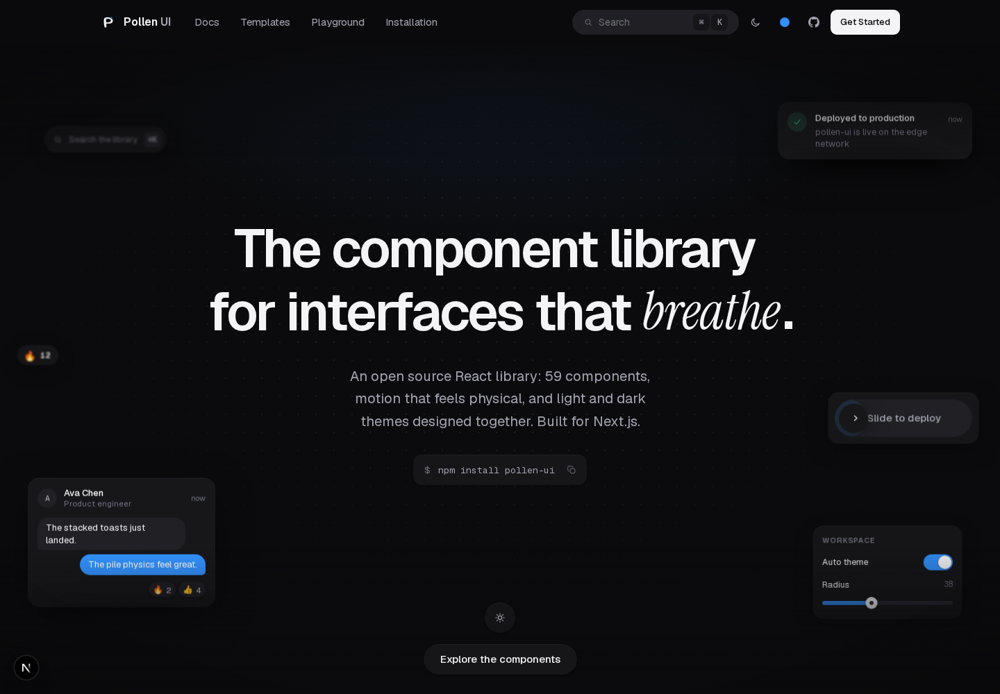
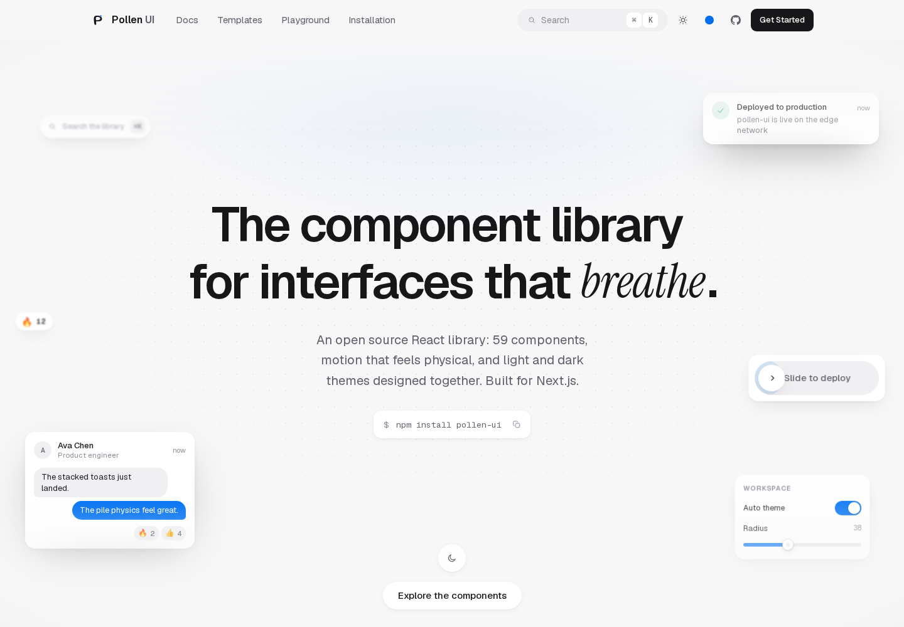
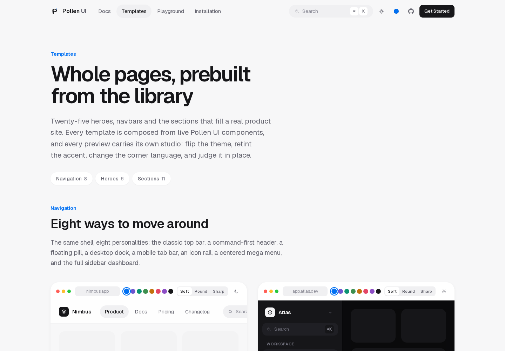
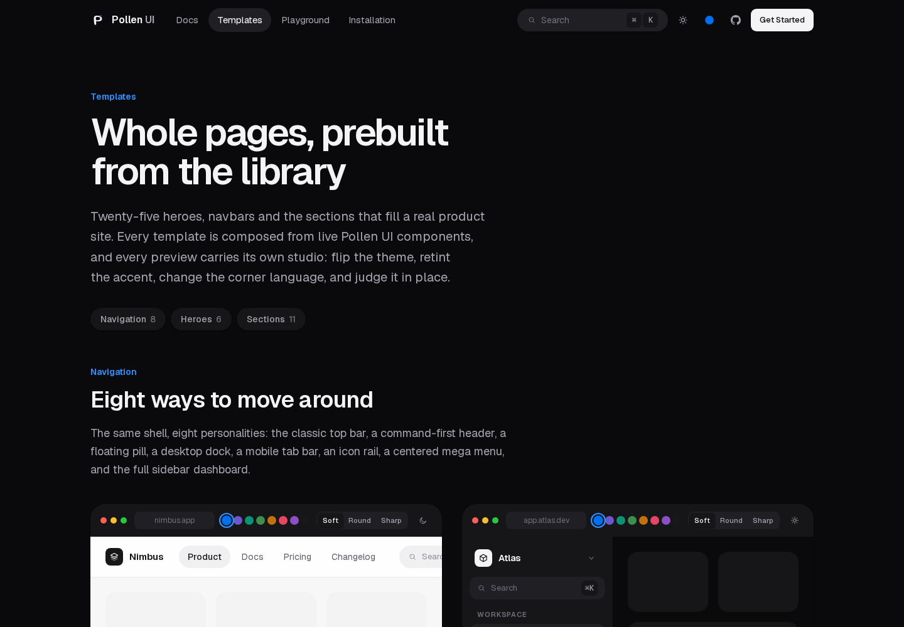
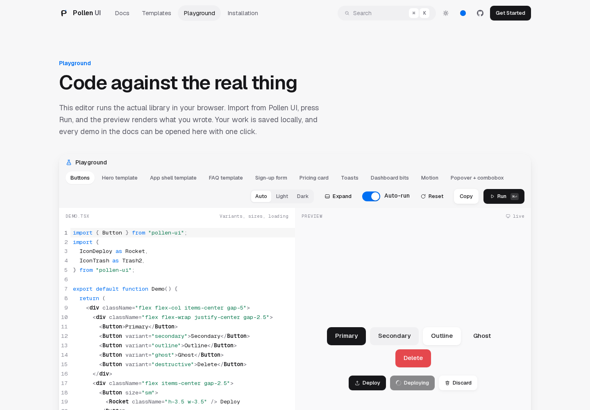
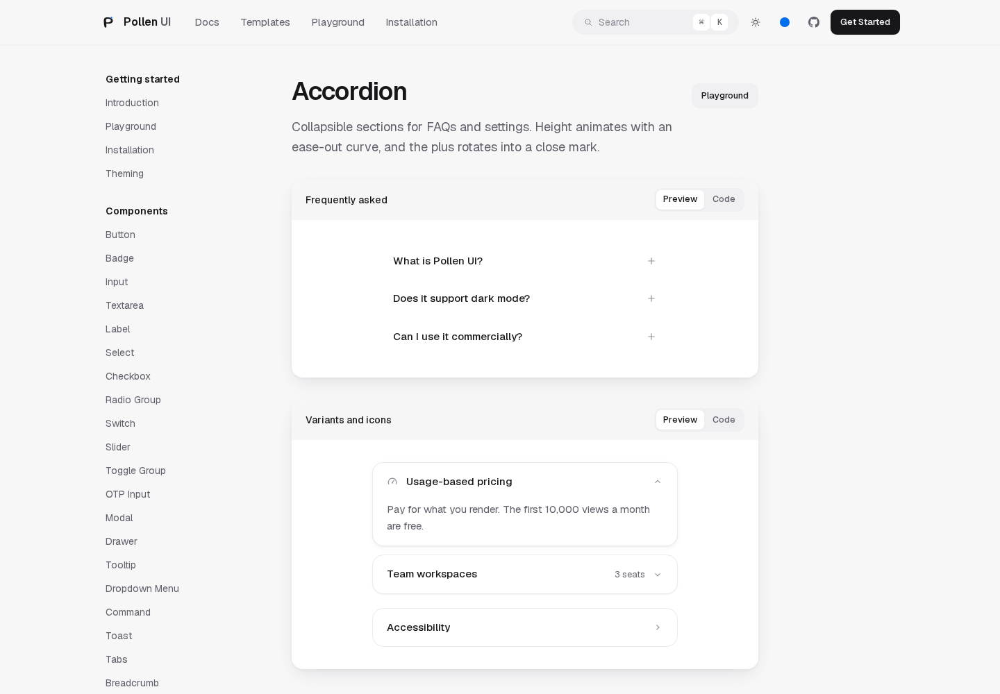
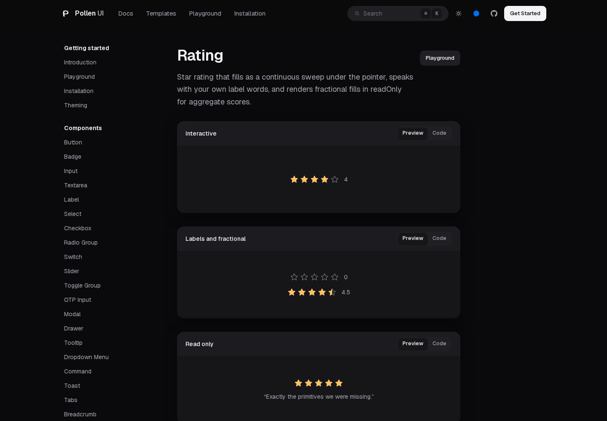
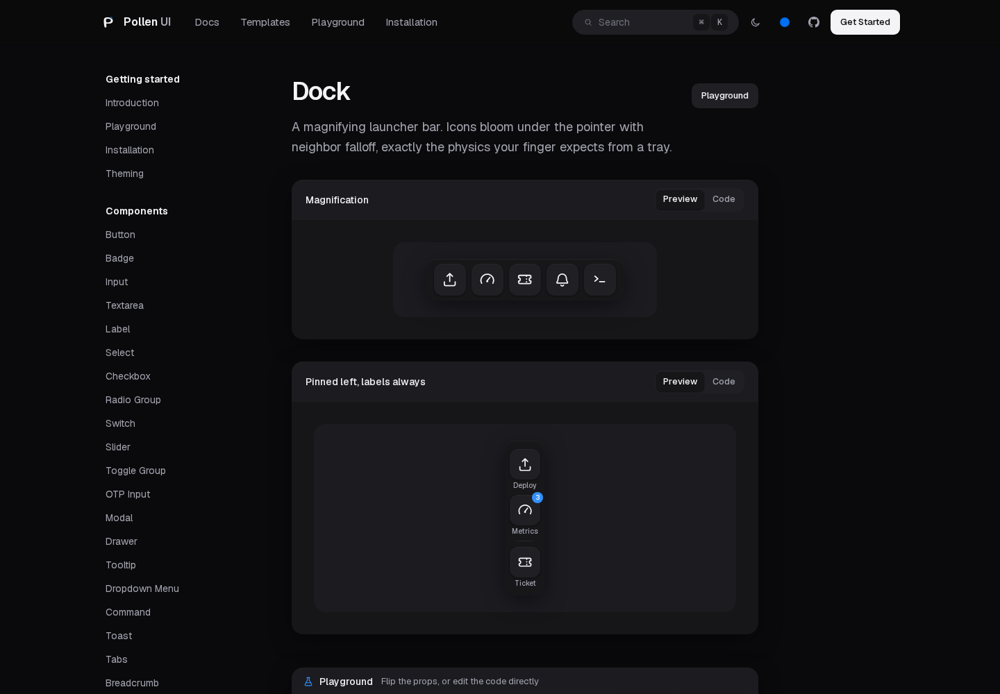

<div align="center">

# Pollen UI

**React components for Next.js, with a design language that behaves.**

Careful typography, layered shadows instead of borders, one blue accent
used like punctuation, and spring motion that only shows up where things
can be interrupted. Light and dark are both first-class.

[](LICENSE)
[](https://www.npmjs.com/package/pollen-ui)
[](https://react.dev)
[](https://nextjs.org)
[](https://tailwindcss.com)
[](.github/workflows/ci.yml)

[Documentation](https://github.com/1-Pankaj/pollen-ui#run-the-docs-site) ·
[Playground](#site-features) ·
[Templates](#site-features) ·
[React Native](#react-native) ·
[Contributing](CONTRIBUTING.md)



</div>

## Why another component library

Most component kits hand you a catalog and let the details drift.
Pollen UI is built around a smaller idea: every component obeys the
same design rules, so an app assembled from them looks like it was
designed by one person.

- **Achromatic, then one accent.** Near-black ink on white surfaces,
  `#0070f3` where the eye needs to land, nothing else competing.
- **Shadows, not lines.** Nothing on screen is drawn with a hard
  border; surfaces separate through soft elevation and tonal fills.
- **Motion with rules.** Ease-out entrances under 300ms, springs only
  where interruptions happen, overlays scaling from their trigger —
  never from scale zero.
- **Dark mode is a real theme**, driven entirely by CSS variables and
  re-tintable in one file.

## Packages

This repository is a small monorepo with three published packages:

| Package | What it is |
| --- | --- |
| [`pollen-ui`](packages/pollen-ui) | The web library: 63 components in five families, 103 icons, TypeScript types, stylesheet and Tailwind bridge. |
| [`@pollen/tokens`](packages/tokens) | The design tokens as installable TypeScript — colors, surfaces, shadows, radii, spacing, type scale, spring presets. |
| [`@pollen/native`](packages/native) | The same design language on iOS and Android: React Native primitives sharing the tokens core. |

## Getting started

Pollen UI targets React 18+ with Tailwind CSS 4 configured — Next.js
(App Router or Pages Router), Vite, Remix, Astro islands, anywhere
React renders.

### Install

Once the package is on the npm registry (the release flow is set up in
`.github/workflows/release.yml`):

```bash
npm install pollen-ui
```

Right now, install straight from this repository:

```bash
git clone https://github.com/1-Pankaj/pollen-ui.git
cd pollen-ui
npm install
npm run build:lib
npm install ./packages/pollen-ui
```

### Wire up Tailwind once

```css
/* app/globals.css */
@import "tailwindcss";
@import "pollen-ui/styles.css";
@import "pollen-ui/theme.css";
@source "../node_modules/pollen-ui/dist";
```

- `styles.css` — design tokens, focus styles and keyframes.
- `theme.css` — the Tailwind 4 bridge: maps utilities like `bg-card`,
  `text-faint` and `bg-fill-strong` onto the tokens so component
  colors follow light and dark automatically.
- `@source` — points your Tailwind build at the installed package.

### Use any component

```tsx
import { Button } from "pollen-ui";

export default function Page() {
  return <Button>Ship it</Button>;
}
```

Fonts: the components expect Geist Sans/Mono (and use Instrument Serif
for display accents on the docs site). On Next.js, load them with
`next/font/google`; the Installation page of the docs site shows the
exact snippet.

## What is inside

63 components in five families, plus 103 hand-drawn icons — 229 value
exports in total:

| Family | Components |
| --- | --- |
| **Primitives** | Button, Badge, Input, Textarea, Label, Select, Combobox, Checkbox, Radio Group, Switch, Slider, Rating, Tag Input, Toggle Group, OTP Input, Pagination |
| **Overlays** | Modal, Drawer, Popover, Tooltip, Dropdown Menu, Context Menu, Command, Toast, Toast Pile |
| **Display** | Tabs, Breadcrumb, Accordion, Avatar, Alert, Skeleton, Spinner, Progress, Progress Ring, Kbd, Table, Card, Code Block, Segmented Control, Steps, Timeline, Stat, Empty State |
| **Motion** | Reveal, Text Reveal, Marquee, Scroll Progress, Parallax, Number Ticker, Typewriter |
| **Signatures** | Dock, Kinetic Headline, Magnetic Button, Odometer, Scramble Text, Slide to Confirm, Chat, Pressable Card, Ticket Card, Tilt Card |

Every component is documented with a live demo, a props table and a
playground — 69 pages under `/docs` (63 components plus the setup,
theming, frameworks, mobile, licensing and React Native guides).

## Site features

The repository includes a full documentation site, and it exercises
everything the library ships:

- **Playground on every component page** — a CodeMirror editor plus an
  in-browser build of the real library. Components with a prop spec
  get a live props pane: flip a variant, watch the snippet rewrite
  itself. Syntax and runtime errors surface in an error pane, code
  persists locally per component.
- **Theme Studio** — pick an accent, tint surfaces, set shadow depth,
  flip dark mode; the preview is live and the equivalent CSS is
  copyable.
- **Templates gallery** — prebuilt heroes, navbars and page sections,
  each preview carrying its own light/dark switch. Every template opens
  into a page with the complete copyable source, a TypeScript/JavaScript
  switch, the components it uses, and an AI-agent prompt.
- **Command palette** — Cmd/Ctrl+K indexes all 63 documented
  components with icons and descriptions.

## React Native

[`@pollen/native`](packages/native) brings the design language to iOS
and Android — Button, Input, Card, Checkbox, SegmentedControl, PinInput,
Rating, Stepper and more, sixteen primitives in all — with Reanimated
springs and shadows derived from the shared tokens. Each primitive is
implemented with platform APIs, so the same design language runs on
both platforms.

Works with Expo and NativeWind 4. See the
[package README](packages/native/README.md) for setup.

## Screenshots

| | |
| --- | --- |
| Home, dark |  |
| Home, light |  |
| Templates, light |  |
| Templates, dark |  |
| The Playground |  |
| Docs: accordion, light |  |
| Docs: rating, dark |  |
| Docs: dock, dark |  |

## Run the docs site locally

```bash
npm install
npm run dev
```

Open http://localhost:3000. Press Cmd+K (or Ctrl+K) to search the docs.

## Scripts

| Command | What it does |
| --- | --- |
| `npm run dev` | Start the documentation site |
| `npm run build` | Build the documentation site |
| `npm run build:lib` | Build `pollen-ui` to `packages/pollen-ui/dist` |
| `npm run typecheck` | Type-check the site |
| `npm run typecheck:lib` | Type-check the library standalone |
| `npm run lint` | Lint everything |
| `npm run check:tokens` | Verify token agreement across packages |

## Contributing

Contributions are welcome. Read [CONTRIBUTING.md](CONTRIBUTING.md) for
the setup, the house rules (the design language is frozen, and that is
the point), and the checks a pull request needs to pass. Please note
this project follows the [Code of Conduct](CODE_OF_CONDUCT.md).
Security issues go through [SECURITY.md](SECURITY.md), not the issue
tracker.

## License

[MIT](LICENSE) — © 2026 Pankaj Israni.

The two typefaces are separately licensed: Geist and Instrument Serif
are distributed under the SIL Open Font License and loaded through
Google Fonts / Fontsource, which keeps the library itself
font-license-clean.
